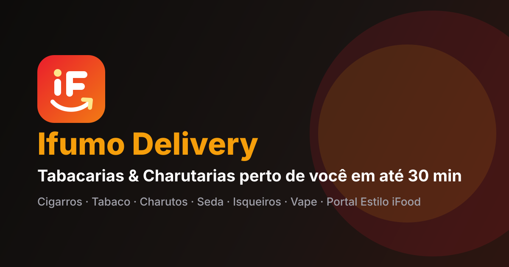
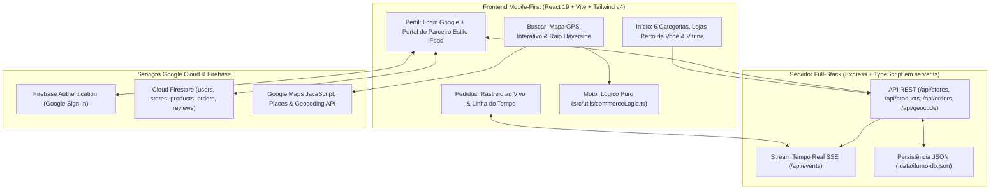

<div align="center">


# iFumo — Delivery de Tabacarias & Charutarias

**Plataforma Mobile-First de Delivery Express (até 30 min) para Tabacarias, Charutarias e Headshops com Portal do Parceiro Estilo iFood, Geolocalização GPS em Tempo Real, Login com Google e Sincronização Cloud Firestore + SSE.**

[](https://react.dev/)
[](https://www.typescriptlang.org/)
[](https://tailwindcss.com/)
[](https://firebase.google.com/)
[](https://expressjs.com/)
[](https://schema.org/)

<br />



</div>

---

## Sumário

1. [Visão Geral](#-visão-geral)
2. [Principais Funcionalidades](#-principais-funcionalidades)
3. [Portal do Parceiro Estilo iFood (Aba Perfil)](#-portal-do-parceiro-estilo-ifood-aba-perfil)
4. [Arquitetura do Sistema](#-arquitetura-do-sistema)
5. [Estrutura do Repositório](#-estrutura-do-repositório)
6. [Referência da API REST & Tempo Real (SSE)](#-referência-da-api-rest--tempo-real-sse)
7. [Banco de Dados & Segurança (Cloud Firestore)](#-banco-de-dados--segurança-cloud-firestore)
8. [SEO, Favicon Estilo iFood & Dados Estruturados](#-seo-favicon-estilo-ifood--dados-estruturados)
9. [Instalação e Execução Local](#-instalação-e-execução-local)
10. [Testes Automatizados e Qualidade de Código](#-testes-automatizados-e-qualidade-de-código)
11. [Documentação Complementar](#-documentação-complementar)

---

## Visão Geral

O **iFumo** é uma aplicação web progressiva (*mobile-first*) projetada para conectar clientes maiores de 18 anos às tabacarias e charutarias cadastradas mais próximas, com entrega expressa por motoboy em até **30 minutos**.

A plataforma opera sob a diretriz **Zero Mock / 100% Plataforma Oficial**:
- **Nenhum estabelecimento ou produto fictício é exibido**: apenas lojas e produtos oficialmente registrados dentro da plataforma aparecem em **"Lojas perto de você"**, no **Mapa GPS** e na **Vitrine de Produtos**.
- **Cadastro Exclusivo no Perfil**: o registro da tabacaria, o gerenciamento do cardápio por categoria e o controle operacional de pedidos ficam concentrados no **Portal do Parceiro Estilo iFood** dentro da aba **Perfil**.
- **Pagamento na Entrega**: o cliente escolhe diretamente no fechamento do pedido se pagará na entrega via **Pix (QR Code)**, **Cartão de Crédito/Débito (Maquininha)** ou **Dinheiro (com cálculo de troco)**.

---

## Principais Funcionalidades

### Para o Cliente
- **Layout Mobile-First de Alta Conversão**:
  - Seletor de endereço no topo com geocodificação real (Google Geocoding + OpenStreetMap Nominatim) e botão **Usar Meu GPS Atual**.
  - Barra de busca instantânea por tabacaria, cigarro, tabaco, charuto, seda, isqueiro ou vape.
  - Banner dinâmico **Entrega em até 30 min** com atalho direto para o mapa de tabacarias abertas.
- **6 Categorias Oficiais**:
  - Navegação circular rápida por **Cigarros**, **Tabaco**, **Charutos**, **Seda**, **Isqueiros** e **Vape**.
- **Busca Geoespacial de Lojas Abertas**:
  - Cálculo exato de distância em quilômetros via fórmula de **Haversine** (`src/utils/commerceLogic.ts`), tempo estimado de entrega (ETA) e filtro de lojas abertas no raio selecionado.
- **Pagamento Decidido na Entrega**:
  - **Pix na Entrega** (QR Code apresentado pelo motoboy).
  - **Cartão na Entrega** (Maquininha de Crédito ou Débito).
  - **Dinheiro na Entrega** (com campo para informar troco).
- **Login com Google & Dados Salvos**:
  - Autenticação real com `GoogleAuthProvider` do Firebase Auth.
  - Sincronização automática de nome, endereço padrão, telefone/WhatsApp, pontos do **Clube iFumo** e histórico de pedidos.
- **Rastreio Ao Vivo do Pedido**:
  - Linha do tempo interativa sincronizada via **Server-Sent Events (SSE)** com atualização instantânea quando o estabelecimento muda o status para **Em Preparo**, **Enviado** ou **Entregue**.

---

## Portal do Parceiro Estilo iFood (Aba Perfil)

Ao acessar a aba **Perfil**, o parceiro encontra o **Portal do Parceiro · Estilo iFood**, dividido em 4 módulos operacionais:

| Aba do Portal | Funcionalidade Principal | Detalhes Operacionais |
| :--- | :--- | :--- |
| **1. Cadastrar Loja** | Registro e gestão da tabacaria | Nome, bairro, endereço completo com geocodificação automática, coordenadas GPS, especialidade, tempo/taxa de entrega e botão **Aberto / Fechado**. |
| **2. Cardápio iFood** | Cadastro de produtos por categoria | Criação de produtos vinculados à loja, galeria de fotos reais em 1 clique (**Marlboro**, **Camel**, **Kretek**, **Harmony**, **Charutos**, **Seda RAW/OCB**, **Vape**) ou URL própria, edição inline de preço, botão **Ativo / Pausado** e exclusão de item. |
| **3. Pedidos** | Acompanhamento e despacho | Fila em tempo real com filtros (`Todos`, `Abertos`, `Enviados`, `Entregues`) e botões diretos: **Em Preparo**, **Passar para Enviado**, **Passar para Entregue** e **Cancelar**. |
| **4. Chat & Push** | Suporte 24h e alertas | Chat em tempo real com clientes e disparo de notificações push para o Clube iFumo. |

---

## Arquitetura do Sistema



---

## Estrutura do Repositório

```text
ifumo-delivery/
├── docs/
│   ├── ARCHITECTURE.md               # Arquitetura detalhada, fluxos SSE e decisões técnicas
│   └── API_REFERENCE.md              # Documentação completa dos endpoints REST e payloads
├── public/
│   ├── favicon.svg                   # Favicon vetorial estilo iFood (sorriso de entrega + iF)
│   ├── icon.svg                      # Ícone principal para PWA e navegadores modernos
│   ├── og-banner.svg                 # Banner 1200x630 para compartilhamento OpenGraph / Twitter
│   ├── robots.txt                    # Diretivas para indexadores de busca
│   └── sitemap.xml                   # Mapa de URLs para SEO
├── src/
│   ├── assets/images/                # Fotos reais de produtos (Marlboro, Camel, Kretek, Harmony, etc.)
│   ├── components/
│   │   ├── AdminAndSupportSection.tsx # Portal do Parceiro Estilo iFood (Lojas, Cardápio, Pedidos, Chat)
│   │   ├── AgeGateModal.tsx          # Verificação obrigatória de maioridade (+18 anos)
│   │   ├── GeoMapSection.tsx         # Mapa interativo Google Maps + cálculo de rota e raio
│   │   ├── LoyaltyAndReviewsSection.tsx # Clube de Fidelidade gamificado e avaliações verificadas
│   │   ├── OrderTrackingModal.tsx    # Modal de acompanhamento de entrega em tempo real
│   │   └── PaymentCheckoutModal.tsx  # Checkout com pagamento na entrega (Pix, Cartão ou Dinheiro)
│   ├── data/
│   │   └── mockCatalog.ts            # Tipagens TypeScript, estados iniciais limpos e galeria de fotos reais
│   ├── utils/
│   │   ├── commerceLogic.ts         # Funções puras (Haversine, ETA, carrinho, fidelidade, cupom)
│   │   └── commerceLogic.test.ts    # Suíte de testes unitários automatizados (node:test)
│   ├── App.tsx                       # Componente raiz, estado global, listeners Firestore e SSE
│   ├── firebase.ts                   # Inicialização do Firebase SDK (Auth + Firestore)
│   ├── index.css                     # Design system Tailwind CSS v4 e utilitários customizados
│   └── main.tsx                      # Ponto de entrada React 19
├── .env.example                      # Exemplo de variáveis de ambiente
├── firebase-blueprint.json           # Esquema estrutural das coleções do Cloud Firestore
├── firestore.rules                   # Regras de segurança do Cloud Firestore com validação de schema
├── index.html                        # HTML principal com SEO completo, OpenGraph e Schema.org JSON-LD
├── metadata.json                     # Metadados oficiais da aplicação e permissões de geolocalização
├── package.json                      # Dependências e scripts de execução
├── server.ts                         # Servidor Express + API REST + Server-Sent Events (SSE)
└── vite.config.ts                    # Configuração do Vite + Tailwind v4 + PWA Manifest
```

---

## Referência da API REST & Tempo Real (SSE)

O servidor `server.ts` expõe endpoints RESTful sincronizados em tempo real via Server-Sent Events (`/api/events`):

| Método | Rota | Descrição | Evento SSE Disparado |
| :--- | :--- | :--- | :--- |
| `GET` | `/api/bootstrap` | Carrega lojas, produtos, pedidos, avaliações e mensagens cadastradas | — |
| `GET` | `/api/events` | Canal Server-Sent Events (SSE) para sincronização instantânea | `connected` |
| `POST` | `/api/stores` | Cadastra um novo estabelecimento no Perfil | `store_created` |
| `PATCH` | `/api/stores/:storeId/status` | Alterna status **Aberto / Fechado** do estabelecimento | `store_updated` |
| `POST` | `/api/products` | Publica um novo produto no **Cardápio Estilo iFood** | `product_created` |
| `PATCH` | `/api/products/:productId` | Atualiza preço ou disponibilidade (**Ativo / Pausado**) do produto | `product_updated` |
| `DELETE` | `/api/products/:productId` | Remove um produto do cardápio do estabelecimento | `product_deleted` |
| `POST` | `/api/orders` | Registra um novo pedido com pagamento na entrega | `order_created` |
| `PATCH` | `/api/orders/:orderId/status` | Atualiza pedido para `preparing`, `delivering` (**Enviado**), `delivered` (**Entregue**) ou `cancelled` | `order_updated` |
| `GET` | `/api/geocode?address=...` | Geocodifica qualquer endereço real para coordenadas `lat` e `lng` | — |
| `GET` | `/api/tabacarias/nearby` | Filtra estabelecimentos cadastrados abertos dentro do raio em km | — |

> Consulte a documentação detalhada com exemplos de requisição e resposta em [`docs/API_REFERENCE.md`](docs/API_REFERENCE.md).

---

## Banco de Dados & Segurança (Cloud Firestore)

Além da persistência rápida no backend Express, o aplicativo sincroniza documentos em tempo real no **Cloud Firestore** com regras de segurança rigorosas (`firestore.rules`):

- **`/users/{userId}`**: Perfil do usuário autenticado via Google, endereço padrão, telefone e pontuação de fidelidade (leitura e escrita restritas ao próprio dono `isOwner(userId)`).
- **`/stores/{storeId}`**: Estabelecimentos oficialmente cadastrados na plataforma com validação de coordenadas (`lat`, `lng`), endereço e proprietário (`ownerId`).
- **`/products/{productId}`**: Itens do cardápio estilo iFood vinculados a um `storeId`, validando categoria (`Cigarros`, `Tabaco`, `Charutos`, `Seda`, `Isqueiros`, `Vape`), preço positivo e status de estoque (`inStock`).
- **`/orders/{orderId}`**: Pedidos realizados pelos clientes com histórico e status de entrega.
- **`/reviews/{reviewId}`** e **`/supportMessages/{messageId}`**: Avaliações verificadas e mensagens do chat 24h.

---

## SEO, Favicon Estilo iFood & Dados Estruturados

O projeto implementa práticas avançadas de **Search Engine Optimization (SEO)** e compartilhamento social:

1. **Favicon Vetorial Estilo iFood (`/public/favicon.svg`)**:
   - Ícone em formato *squircle* com gradiente vibrante vermelho/âmbar (`#EA1D2C` → `#F59E0B`), tipografia **iF** com brasa acesa e a clássica **seta curva em formato de sorriso** indicando entrega expressa.
2. **Meta Tags e OpenGraph / Twitter Cards (`index.html`)**:
   - Tags `<title>`, `<meta name="description">`, `og:title`, `og:description`, `og:image` (`/og-banner.svg`), `twitter:card` (`summary_large_image`) e resolução dinâmica de `<link rel="canonical">`.
3. **Dados Estruturados Schema.org (`application/ld+json`)**:
   - Grafo JSON-LD embutido com `WebApplication`, `OnlineBusiness` e `FAQPage` para habilitar *Rich Snippets* nos mecanismos de busca.
4. **Indexação (`robots.txt` e `sitemap.xml`)**:
   - Arquivos públicos configurados para orientar crawlers de busca.

---

## Instalação e Execução Local

### Pré-requisitos
- **Node.js** `>= 20.x`
- **npm** `>= 10.x`

### 1. Clonar o repositório e instalar dependências
```bash
git clone https://github.com/seu-usuario/ifumo-delivery.git
cd ifumo-delivery
npm install
```

### 2. Configurar variáveis de ambiente
Copie o arquivo `.env.example` para `.env`:
```bash
cp .env.example .env
```
As principais variáveis opcionais em `.env.example` incluem:
- `GEMINI_API_KEY`: Chave para recursos de servidor caso utilizados.
- `GOOGLE_MAPS_API_KEY`: Chave opcional do Google Maps / Places / Geocoding no backend (o sistema possui fallback automático para OpenStreetMap Nominatim caso não configurada).

### 3. Iniciar o servidor de desenvolvimento (Full-Stack na porta 3000)
```bash
npm run dev
```
Acesse `http://localhost:3000` no navegador.

---

## Deploy na Vercel (Produção 100% Funcional)

O projeto já está 100% preparado para deploy na **Vercel** (via integração com GitHub ou Vercel CLI), combinando frontend estático Vite (`dist/`) com **Vercel Serverless Functions** (`/api/index.ts`) e sincronização em tempo real no **Cloud Firestore**:

1. **Roteamento Serverless (`vercel.json` + `/api/index.ts`)**:
   - Todas as chamadas `/api/*` (`/api/stores`, `/api/products`, `/api/orders`, `/api/geocode`, `/api/sync`, `/api/state`) são roteadas para a Serverless Function em `/api/index.ts`.
   - O sistema detecta automaticamente o ambiente Vercel (`process.env.VERCEL`) e utiliza `os.tmpdir()` para gravação segura sem erro de sistema de arquivos somente-leitura (`EROFS`).
2. **Persistência Tripla Resiliente a Cold Starts**:
   - **Cloud Firestore (`onSnapshot`)**: Lojas (`stores`), produtos do cardápio iFood (`products`) e avaliações (`reviews`) públicos são sincronizados em tempo real para todos os visitantes da URL na Vercel.
   - **Hidratação Automática (`POST /api/sync`) + Endpoints Idempotentes**: Caso uma instância serverless da Vercel sofra *cold start*, o cliente reidrata automaticamente o estado e todas as rotas `PATCH`/`DELETE` realizam *upsert* transparente.
   - **Cache Local (`localStorage`)**: Garante funcionamento imediato mesmo antes do login com Google.

### Como publicar na Vercel:
```bash
# Opção 1: Conecte seu repositório GitHub diretamente no painel da Vercel
# Framework Preset: Vite | Build Command: npm run build | Output Directory: dist

# Opção 2: Via Vercel CLI
npx vercel --prod
```
> **Importante para Login com Google na Vercel**: Após gerar seu domínio `.vercel.app`, adicione-o em **Firebase Console → Authentication → Settings → Authorized domains** para habilitar o popup de login do Google em produção.

---

## Testes Automatizados e Qualidade de Código

A lógica pura de negócios (cálculo geoespacial Haversine, ETA de entrega, totais de sacola, descontos de cupom e níveis de fidelidade) é desacoplada em `src/utils/commerceLogic.ts` e testada via `node:test`:

```bash
# Executar testes unitários da lógica de negócios
npx tsx --test src/utils/commerceLogic.test.ts

# Verificar tipagem TypeScript (Lint)
npm run lint

# Validar regras de segurança do Firestore
npx eslint firestore.rules

# Gerar build de produção otimizado
npm run build
```

---

## Documentação Complementar

- [**Arquitetura & Fluxos de Dados (`docs/ARCHITECTURE.md`)**](docs/ARCHITECTURE.md)
- [**Referência Completa da API & SSE (`docs/API_REFERENCE.md`)**](docs/API_REFERENCE.md)

---

<div align="center">
  <sub>Desenvolvido com foco em performance Mobile-First, geolocalização real e experiência de parceiro estilo iFood. Proibido para menores de 18 anos.</sub>
</div>
