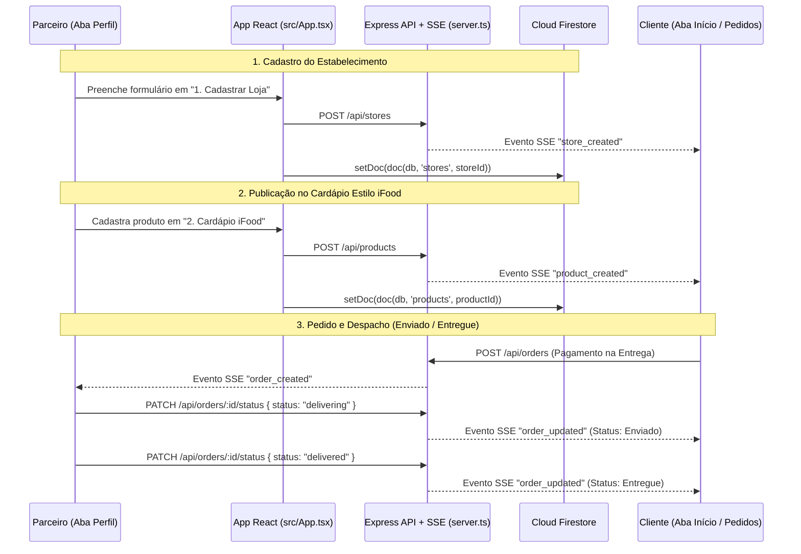

# Arquitetura do Sistema — iFumo Delivery

Este documento detalha a arquitetura técnica, o fluxo de estado em tempo real e as decisões de engenharia adotadas no **iFumo — Delivery de Tabacarias & Charutarias**.

---

## 1. Princípios Arquiteturais

1. **Zero Mock / Curadoria Oficial**:
   - Nenhuma loja ou produto fictício é pré-carregado no estado inicial (`PARTNER_STORES = []`, `INITIAL_PRODUCTS = []`).
   - Apenas estabelecimentos registrados no **Portal do Parceiro (Aba Perfil)** e produtos cadastrados no **Cardápio Estilo iFood** são exibidos aos consumidores.
2. **Arquitetura Híbrida em Tempo Real (Express SSE + Cloud Firestore)**:
   - O backend Express (`server.ts`) persiste dados instantaneamente em `.data/ifumo-db.json` e transmite eventos via **Server-Sent Events (`/api/events`)** para todos os clientes conectados.
   - Paralelamente, quando o usuário se autentica via **Google Sign-In**, o aplicativo sincroniza coleções no **Cloud Firestore** (`users`, `stores`, `products`, `orders`, `reviews`, `supportMessages`) usando `onSnapshot`.
3. **Motor Geoespacial Desacoplado (`src/utils/commerceLogic.ts`)**:
   - Cálculos matemáticos de distância por coordenadas GPS (Fórmula de Haversine), estimativa de tempo de entrega (ETA), cálculo de subtotal/frete/desconto e progressão de fidelidade são implementados como funções puras e testadas isoladamente.

---

## 2. Fluxo Operacional do Parceiro (Estilo iFood)

---

## 3. Camadas da Aplicação

### 3.1 Frontend (`src/`)
- **`src/App.tsx`**: Gerencia navegação mobile-first (`home`, `search`, `orders`, `profile`), carrinho de compras, autenticação Google, filtros por categoria e loja, e conexão com o stream SSE `/api/events`.
- **`src/components/AdminAndSupportSection.tsx`**: Implementa o **Portal do Parceiro · Estilo iFood** com 4 abas:
  - `1. Cadastrar Loja`: Formulário com geocodificação integrada e botão **Usar Meu GPS**, além da lista de lojas cadastradas com chaveamento **Aberto / Fechado**.
  - `2. Cardápio iFood`: Cadastro de produtos com galeria de fotos reais (Marlboro, Camel, Kretek, Harmony, Charutos, Seda RAW/OCB, Vape), agrupamento pelas 6 categorias, edição inline de preço, botão **Ativo / Pausado** e exclusão de item.
  - `3. Pedidos`: Painel operacional com filtros e botões para transicionar pedidos para **Em Preparo**, **Passar para Enviado**, **Passar para Entregue** ou **Cancelar**.
  - `4. Chat & Push`: Suporte em tempo real e envio de alertas promocionais.
- **`src/components/GeoMapSection.tsx`**: Renderiza o mapa interativo Google Maps com marcadores das tabacarias cadastradas na plataforma e cálculo de distância/rota.
- **`src/components/PaymentCheckoutModal.tsx`**: Modal de fechamento de pedido onde o cliente escolhe a forma de pagamento na entrega (**Pix**, **Cartão Crédito/Débito** ou **Dinheiro**).

### 3.2 Backend (`server.ts`)
- Servidor Express unificado que monta o middleware do Vite em desenvolvimento e serve o bundle estático `dist/` em produção na porta `3000`.
- Mantém conexões ativas de Server-Sent Events (`sseClients`) para broadcast imediato de alterações de lojas, cardápio, pedidos e chat.

### 3.3 Segurança (`firestore.rules`)
- Funções auxiliares (`isAuthenticated`, `isOwner`, `hasOnlyAllowedFields`, `isValidStoreCatalogItem`, `isValidProductCatalogItem`, `isValidOrder`, `isValidReview`) garantem validação de tipos, tamanhos de string e propriedade dos documentos antes de qualquer gravação no Cloud Firestore.
